# 琪遇台账（xctally）

> 家庭消耗台账 + 个人随笔 —— 记录**我有什么**（顺带算出**什么时候过期**、**每天值多少钱**、**每月用了多少**），也记录**我经历了什么**（图文随笔，插件式挂载评分 / 价格 / 定位）。
>
> **单机本地工具**：不注册、不联网、不上传。换手机靠导出备份文件。
>
> | | |
> |---|---|
> | App 名称 | 琪遇台账 |
> | 代号 / 仓库 | xctally |
> | 包名 | `com.qiyu.xctally` |
> | 出品 | 琪遇（qiyu） |
> | 当前状态 | **可交互原型 + 两个手机壳**（安卓 APK / 鸿蒙 HAP，见 `apps/`） |
>
> 原型里的 54 项页内自检全过，UI 与业务逻辑只有一份，两个壳共用。

---

## 快速开始

双击打开 `prototype/index.html` 即可，无需安装任何东西。

想要更好看的呈现，用 Chrome / Edge 打开：
- 窗口宽度 ≥ 900px 时会显示手机外框 + 左侧说明栏
- 窄窗口（手机浏览器）会自动铺满全屏

**URL 直达**（方便逐个截图）：

| 地址 | 效果 |
|---|---|
| `index.html#home` | 首页看板 |
| `index.html#items` | 物品列表 |
| `index.html#detail=it_mac` | 物品详情（日均成本衰减曲线） |
| `index.html#energy` | 能源 |
| `index.html#me` | 我的 / 统计 / 备份 |
| `index.html#items?bare&add` | 直接打开「新增记录」表单 |
| `index.html#energy?bare&reading` | 直接打开「抄表」表单 |
| `index.html#collect` | 收藏列表 |
| `index.html#cdetail=c_diary1` | 随笔详情（含插件与图文混排正文） |
| `index.html#collect?bare&cform` | 直接打开「新增随笔」表单 |
| `index.html#cdetail=c_diary1?bare&clong` | 直接生成并预览分享长图（图片会一起画进去） |
| `index.html#me?bare&bimport` | 用一份模拟备份演示「恢复预览 + 冲突保护」 |
| `index.html#selftest` | 跑 **54 项页内自检**（净化 / 压缩 / 编辑往返 / 冲突 / 成本） |
| 加 `?bare` | 隐藏左侧说明栏 |
| 加 `?light` / `?dark` | 强制主题 |

---

## 目录结构

```
xctally/
├─ prototype/            网页应用本体（原生 HTML/CSS/JS，无依赖无构建）
│  ├─ index.html         页面骨架 + 手机外框
│  ├─ styles.css         设计变量与样式（浅深两套主题 + 原生壳模式）
│  ├─ platform.js        平台适配层（浏览器 / 安卓 / 鸿蒙）
│  ├─ icons.js           SF Symbols 风格线性图标集（渲染时把数据里的 emoji 映射成 SVG）
│  ├─ data.js            物品 / 能源数据层：Item / Event / 表具 + 派生计算
│  ├─ collect.js         收藏模块：统一随笔条目 + 插件 + 图文混排正文 + 图片压缩 + 长图导出
│  ├─ backup.js          备份与恢复：导出完整包 / 恢复预览 / 冲突保护式合并
│  ├─ selftest.js        页内自检：#selftest 跑 54 项断言（净化 / 压缩 / 编辑 / 冲突 / 成本）
│  └─ app.js             交互层：五个页面 + 表单 + 事件委托
├─ apps/                 两个手机壳（共用上面这一份网页应用）
│  ├─ android/           安卓壳：WebView + FileProvider + WorkManager 提醒
│  │  └─ README.md       新建项目 / 复制文件 / 打包 APK 的完整步骤
│  └─ harmony/           鸿蒙壳：ArkWeb + 代理提醒
│     └─ README.md       新建项目 / 自动签名 / 打包 HAP 的完整步骤
├─ docs/
│  ├─ image-storage.md   随笔图片的正式版存储方案（为什么不能用 base64）
│  └─ collab-design.md   【已暂缓】曾经设计过的多人协作方案，留档备查
├─ design/
│  ├─ design-tokens.md   设计规范（颜色 / 圆角 / 字体 / 间距 / 动效）
│  ├─ ai-prompts.md      交给别的模型出图的 prompt（图标 / 插画 / 商店截图）
│  ├─ icon.svg           应用图标（矢量源文件）
│  ├─ icon-1024.png      应用图标（1024 位图，可切各尺寸）
│  └─ preview-*.png      各界面预览图
└─ tools/
   ├─ make-previews.py   改完 UI 后重新生成预览图
   └─ sync-app-assets.py 把网页应用同步进两个壳的资源目录
```

---

## 已实现的功能

### 1. 记录「我有什么」（底座）
一条记录 = 名称 + 分类（`日用 · 装饰`）+ 获得日期 + 来源 + 价格 + 数量 + 位置 + 状态 + 照片/备注。
示例就是你的发卡：`2026.03.16 · 商店购买 · ¥9.90 · 日用-装饰`。

录入表单**默认只显示 4 项**（名称/分类/价格/日期），保质期、保修、位置等折叠在「更多选项」里。

### 2. 到期提醒
食品保质期、药品有效期、**开封后效期（PAO）**、耗材更换、电器保修。
分四级提醒：已过期 / ≤3 天 / ≤7 天 / ≤30 天，颜色逐级变化。

### 3. 日均成本
`日均成本 = (购买价 + 维修 + 更换 − 处置回收) ÷ 持有天数`，随天数自动下降。
详情页有一条**衰减曲线**（这个 App 的招牌视觉）。列表里每件东西都直接显示 `¥x.xx/天`。

### 4. 能源台账
电/水/气三只表具：本月用量与费用、**阶梯进度与当前档位单价**、近 12 个月用量柱状图、环比涨跌。
可以抄表记一笔，阶梯价与趋势自动重算。

### 5. 收藏（随笔）
收藏只有**一种条目**，不再分日记 / 零食 / 影视 / 游玩 —— 差异靠**插件**表达，想加就加：

| 插件 | 作用 |
|---|---|
| ⭐️ 评分 | 1–5 星 |
| 💰 价格 | 花了多少钱 |
| 📍 定位 | 地点名 + 坐标 |
| 🔗 链接 | 相关网址 |
| 🌤 心情 | 当时的心情 |

一条随笔可以只挂「评分 + 价格」（记零食），也可以只挂「定位」（记去哪玩），
或者什么插件都不加纯粹写点东西。**插件注册表是整个模块唯一需要扩展的地方** ——
以后想加「时长」「车牌」这类字段，在 `PLUGINS` 里加一条，再补两个渲染分支即可。

- **随笔正文是图文混排**（像知乎）：文字中间可以穿插图片和动图
  - 工具条：加粗 / 斜体 / 插入图片 / 插入动图 / **删除选中的图片**
  - 支持**直接粘贴截图**，也支持**把图片拖进编辑区**，可一次选多张
  - **插入时自动压缩**：长边 1600px + JPEG q0.82（实测 7.97MB → 1.04MB），
    顺带重编码丢掉 EXIF/GPS；**动图 GIF 一律不重编码**（否则动画就没了）；
    纯色截图若 JPEG 反而更大则保留原图
  - 内容以受限 HTML 存储（只允许 `p` `br` `strong` `em` `img`），
    保存时**净化**：`<script>` 整块删除（内容不会变成正文）、事件属性与 style 全清、
    非 `data:` 的外链图片直接丢弃
- **分类自定义**，与插件解耦，可随时新建
- **一键复制文案**：正文里的图片转成「［图片］」占位，直接粘到朋友圈
- **生成长图**：canvas 排版 1080px 宽，**正文里的图片会一起画进长图**，可预览、可保存
- 支持「编辑」已有随笔，不用删了重写

### 6. 数据只在本机，但随你带走
xctally 是**单机本地工具**：不注册、不联网、不上传，数据存在设备本地。

- **导出完整备份**：物品 + 随笔 + 能源打包成一个 JSON 文件，换手机时用它搬过去
- **从备份恢复**：先算差异并预览（新增 / 相同 / 冲突），确认后才合并
- **冲突保护**：同一 id 两边内容不同 → **默认保留当前设备上的版本**，不会被旧备份覆盖
- **本地占用可见**：显示总占用与其中图片占用；接近浏览器上限（约 5MB）时会提前警告
- 全程不涉及服务器、域名、备案

> 早期设计过一套「邀请好友一起记录」的服务端方案（空间 / 邀请码 / 增量同步 / 冲突留档），
> 已决定**暂缓**，文档保留在 [docs/collab-design.md](docs/collab-design.md) 备查。

---

## 打包成手机 App（自用）

UI 与业务逻辑只有**一份**（`prototype/`），两个壳只负责"装一个浏览器内核 + 接原生能力"：

| 平台 | 壳 | 产物 | 原生能力 |
|---|---|---|---|
| 安卓 | WebView + `WebViewAssetLoader` | `app-debug.apk` | 导出备份→系统分享、系统文件选择器、WorkManager 每日到期通知 |
| 鸿蒙 | ArkWeb + `javaScriptProxy` | `entry-default-signed.hap` | 导出备份到应用目录、DocumentViewPicker 选文件、系统代理提醒 |

**步骤**（详细版见 `apps/android/README.md` 与 `apps/harmony/README.md`）：

```bat
rem 1. 在 Android Studio / DevEco 里各新建一个空项目，然后回到本仓库执行：

rem 安卓（Windows 自带的 PowerShell 5.1 即可，不需要装 PowerShell 7）
tools\copy-android.cmd -Project "C:\Users\你\AndroidStudioProjects\xctally"

rem 鸿蒙
tools\copy-harmony.cmd -Project "D:\DevEcoProjects\xctally"
```

两个 `.cmd` 只是包装：它们自动挑可用的 PowerShell（`pwsh` 或 `powershell`），
并只为这一次运行绕过脚本执行策略。底层 `.ps1` 刻意写成**纯 ASCII 且无 BOM**——
中文 Windows 上 PowerShell 读无 BOM 的脚本会按 GBK 解释，中文字节会吞掉引号导致语法错误；
而部分 pwsh 又不会剥离 BOM，会把 BOM 变成第一个 token。两者都实测过。

改完 `prototype/` 里的任何东西，**重新跑一次复制脚本**，两个 App 就都更新了
（也可以用 `python tools/sync-app-assets.py` 只同步网页资源）。

**为什么用套壳而不是重写两套原生 UI**：重写等于同一套界面维护两遍，且我这边的
54 项自检结果无法复用。套壳方案下，原生代码只有"文件读写 + 通知 + 返回键"三件事，
加起来不到 500 行，出问题也只可能出在这三处。

**没有申请网络权限**：安卓清单里只有通知权限，连 `INTERNET` 都没有 ——
"纯本地、不联网"这件事在系统层面就能被验证。

> ⚠️ **两个壳的原生代码我没有在真机上编译验证过**（本机没有 Android SDK 和 DevEco）。
> 网页应用部分是验证过的（54 项自检全过），壳的 README 里逐条列了需要你确认的地方。
> 建议顺序：先跑通"能打开 → 能记一条 → 数据能留住"，再逐个接原生能力。

---

## 数据模型

两张表就够，派生指标全部实时计算、不落库：

```sql
Item(
  id, name, category, sub, icon,
  acquired_at, source, cost, currency, qty, unit, cost_included,
  status, location, expires_at, opened_at, warranty_until,
  photos, tags, note, created_at, updated_at
)

Event(
  id, item_id, type, happened_at, amount, qty, note,
  prev_reading, curr_reading, unit_price, tier   -- 抄表/账单专用
)

CollectEntry(
  id, title, category, date,
  body_html,      -- 受限 HTML：只允许 p / br / strong / em / img（图片是 base64 或路径）
  plugins_json,   -- [{"k":"rating","v":4}, {"k":"price","v":12.9}, {"k":"place","v":{...}}]
  tags_json, created_at, updated_at
)
```

`CollectEntry.plugins_json` 存 JSON 数组，所以**加新插件类型不需要改表结构** ——
这也是"插件"这个设计的真正好处：评分、价格、定位、链接、心情只是同一张表的五种取值。

`type` 取值：`acquired` 获得 / `opened` 开封 / `used` 使用 / `repaired` 维修 /
`replaced` 更换 / `lent` 借出 / `returned` 归还 / `disposed` 处置 / `reading` 抄表。

**为什么必须有 Event**：没有流水，日均成本永远只能算「购买价 ÷ 天数」，
维修费、耗材、卖出价都进不来 —— 这正是同类 App 被骂「只算不决策」的根因。

---

## 设计规范

完整版见 [design/design-tokens.md](design/design-tokens.md)。要点：

- **圆角**：卡片 22px、按钮 16px、胶囊 999px，圆角随容器尺寸递增
- **配色**：iOS 系统色，一屏内饱和色最多出现 2 处（最重要的数字 + 主操作）
- **字体**：系统字体栈（SF Pro / 苹方），大字号收紧字距（`-0.025em`），**金额与天数一律等宽**
- **分组列表**：一个圆角卡片包多行，行间只用 1px 发丝线（Apple 的标志性结构）
- **阴影**：只用于表达浮起，必须带负扩散让边缘柔和；深色模式改用底色差表达层次
- **动效**：只用缓出曲线，按下必须即时缩放反馈

| 首页 | 物品 | 详情 |
|---|---|---|
| 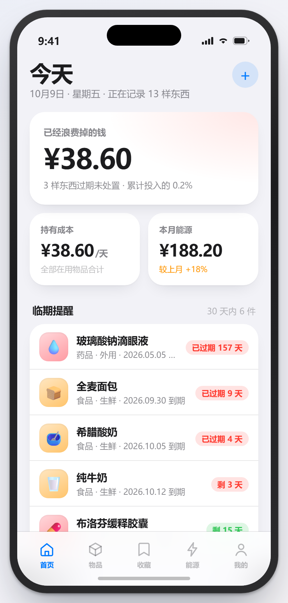 | 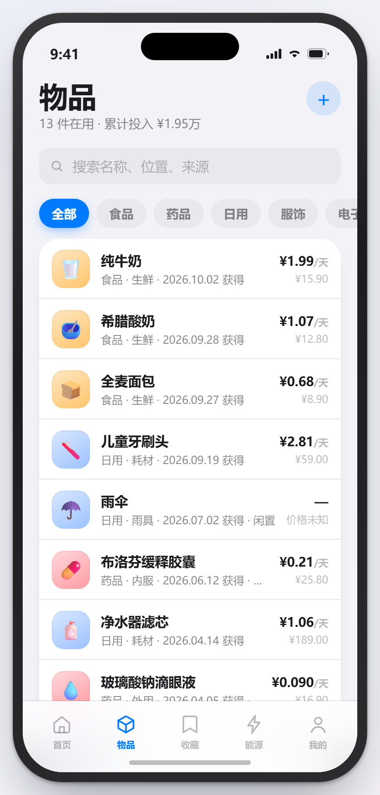 | 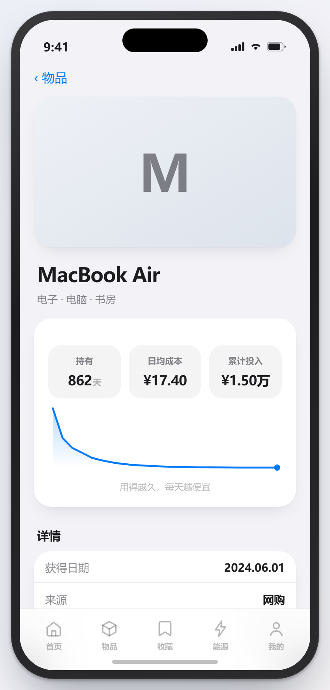 |

| 能源 | 我的 | 新增记录 |
|---|---|---|
| 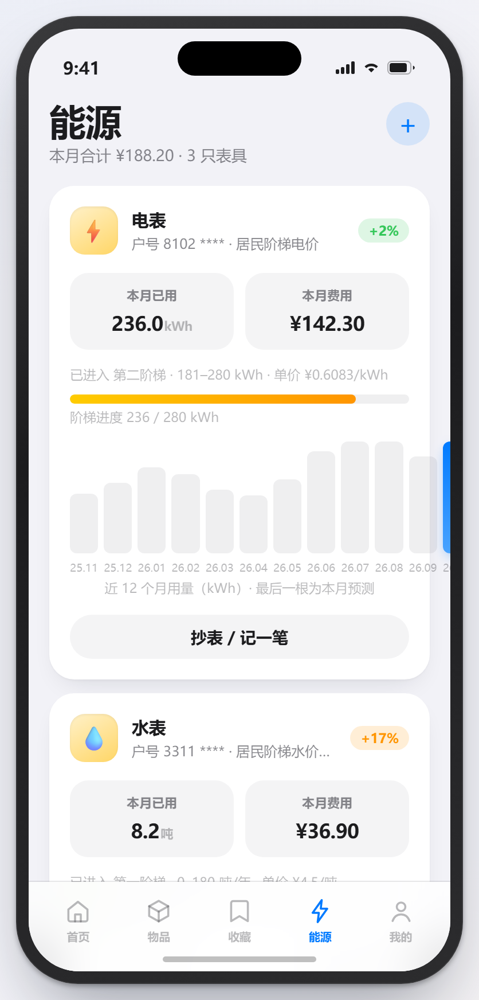 | 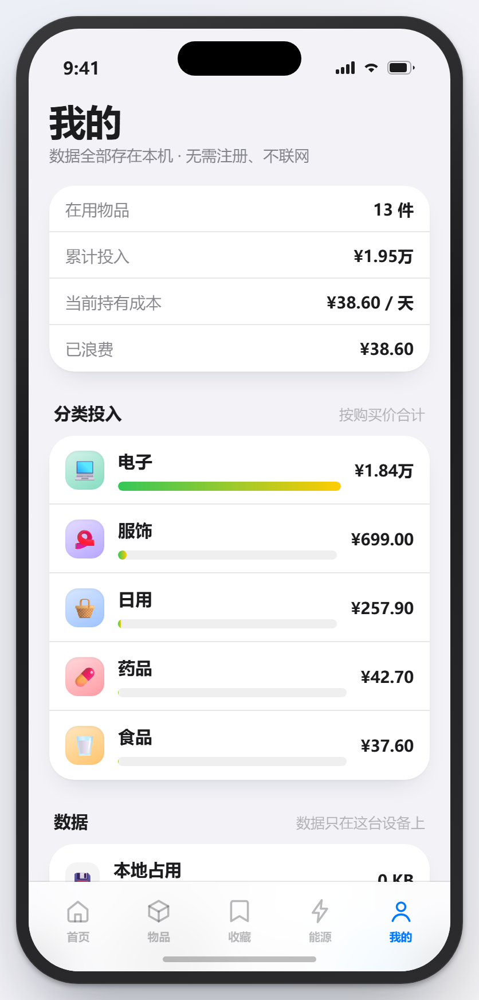 | 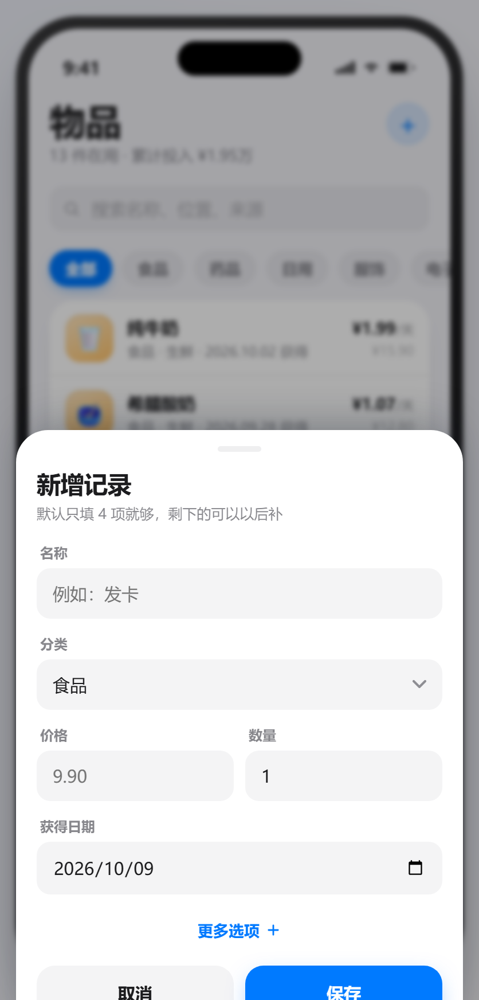 |

**收藏模块：**

| 收藏列表 | 随笔详情 | 长图导出（含正文图片） |
|---|---|---|
| 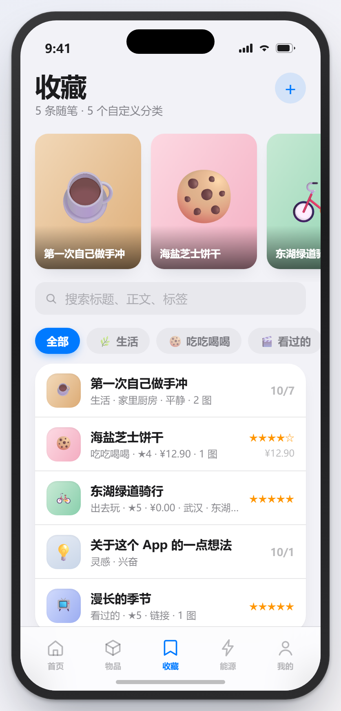 | 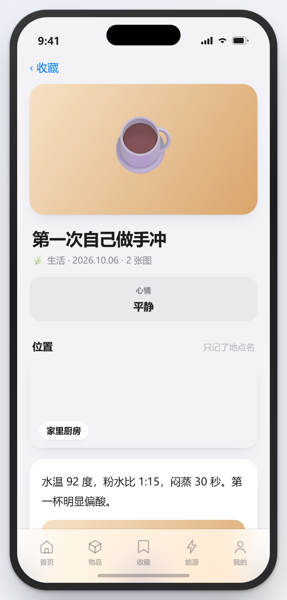 | 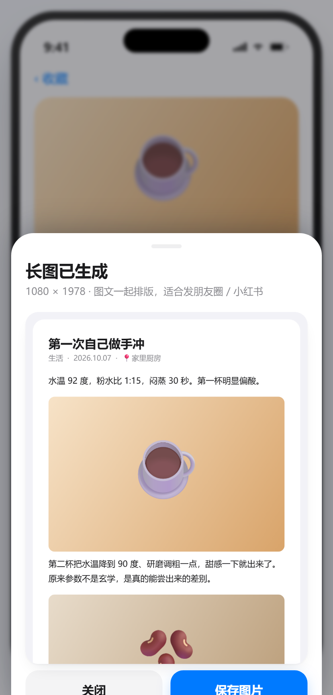 |

| 新增随笔（插件 + 图文编辑器） | 从备份恢复 |
|---|---|
| 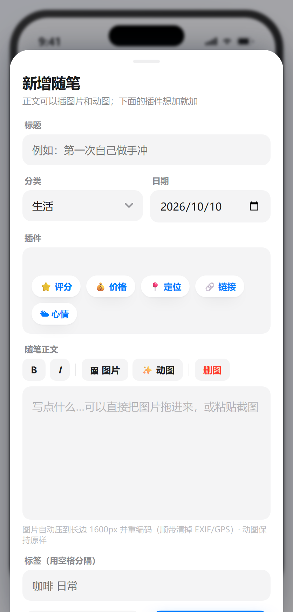 | 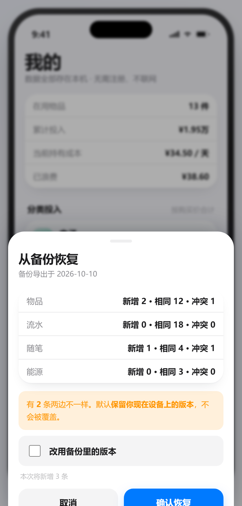 |

**页内自检（`#selftest`，54 项全过）：**

| SELFTEST ALL PASSED · 54/54 |
|---|
| 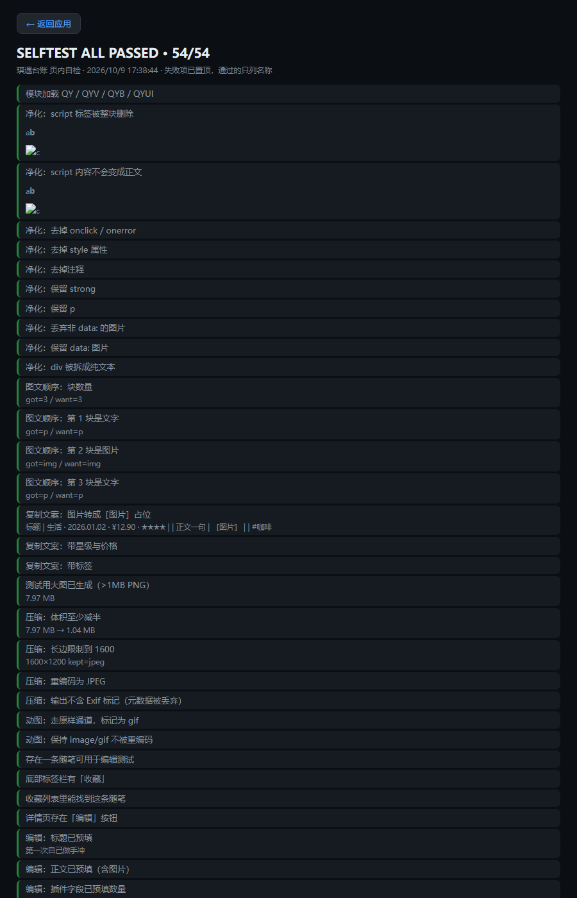 |

> 自检覆盖的是"容易悄悄算错"的地方：富文本净化（含 `<script>` 整块删除）、
> 图片压缩与 EXIF 丢弃、编辑往返（是更新而不是新增）、备份冲突保护、
> 图文顺序、日均成本公式。改完代码跑一次就能知道有没有踩坏东西。

---

## 原型的边界（还没做的）

这是**看设计和验证数据模型**用的原型，不是生产代码：

- 通知是假的（没有真实本地通知 / 推送）
- 没有桌面小组件、没有扫码与 OCR 录入
- 随笔正文里的图片仍是 **base64 存在本地**。插入时已经压过（长边 1600px / JPEG q0.82 /
  动图不重编码 / 丢掉 EXIF），但正式版必须改成「图片存文件、库里只存相对路径」——
  完整方案（目录结构、media 表、迁移步骤、跨平台坑）见 [docs/image-storage.md](docs/image-storage.md)
- 压缩与净化**已经在原型里实现并有自检覆盖**，可以直接搬到正式版
- 长图导出是把正文重新排版到 canvas，**没有做超大正文的分页保护**（几万字会很高）
- 定位只做了接口调用，没接真实地图（`navigator.geolocation` 在 `file://` 下会被浏览器拒绝）
- 没有多设备同步（数据只在本机 localStorage）；换设备靠导出 / 恢复备份文件
- 没有搜索历史、批量录入
- **多人协作已取消**（服务端方案留档在 [docs/collab-design.md](docs/collab-design.md)）
- **两个壳的原生代码未在真机验证**（本机没有 Android SDK 与 DevEco 环境）：
  安卓的每日通知、鸿蒙的代理提醒与文件选择都需要你实机确认，逐条清单在各壳的 README 里
- 没有做性能测试（同类产品「数据一多就闪退」是常见差评点，正式版要测几千条记录）

---

## 下一步建议

1. **定技术栈**：要覆盖 iOS + 安卓 + 鸿蒙，推荐 Flutter（生态最稳）或 uni-app x（中文生态、还能顺手出小程序）。
2. **把数据模型落成 SQLite**，先把派生计算写成有单元测试的纯函数（这是最容易算错、也最影响口碑的地方）。
3. **按这个视觉稿搭第一个真机界面**：首页看板 + 物品列表 + 详情曲线，先跑通闭环。
4. 补 **免费导出** 和 **快速录入** —— 竞品差评最集中的两点，也是最便宜的差异化。
5. **按 [docs/image-storage.md](docs/image-storage.md) 落地图片存储**：图片存文件、库里存相对路径、
   备份改 ZIP。这一步做晚了，用户已有数据的迁移会非常痛苦。
6. 把 `prototype/selftest.js` 里的断言**翻译成正式版的单元测试**（尤其是成本公式与冲突合并），
   再往上加界面测试。

上架与合规路径（备案 / 软著 / 各平台门槛）见对话记录，核心结论：
个人可走 **iOS 海外区 + 华为 + 应用宝 + 荣耀**；国内商店绕不开 **软著 + App 备案**（需域名 + 境内服务器）；
**纯离线**架构能让 iOS 中国区申请到备案豁免，这是本地优先设计最值钱的回报。

---

## 许可证

[MIT](./LICENSE) © 2026 qiyu
